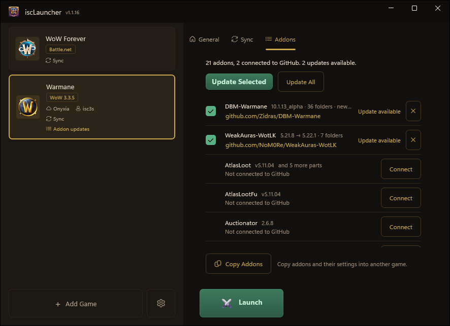

# iscLauncher

A Windows launcher for World of Warcraft that keeps your addons and settings in sync across PCs and game versions.

[](https://github.com/iiisc/iscLauncher/releases/latest)
[](https://github.com/iiisc/iscLauncher/releases/latest)




## What it does

**Private servers**
- Keeps a library of WoW installs, each with its own server address, account and realm.
- Writes `realmlist.wtf` and `WTF\Config.wtf` before every launch, so you never edit them by hand.
- Logs you in: your password is stored in Windows Credential Manager and typed into the login screen once the game is ready. If typing fails, it's copied to the clipboard instead and cleared again after 30 seconds.

**Official Blizzard installs**
- Add any version under your `World of Warcraft` folder (Classic Era, beta, ...) by picking its exe.
- **Open in Battle.net** takes you to the game in Blizzard's launcher, where you press Play. Battle.net handles login, so there's no password to store. (Battle.net offers no way for another app to press Play.)

**Addons and settings**
- **Sync between PCs** through a private GitHub repo: push from one PC, pull on another.
- **Copy Addons** from one game in your library to another, optionally with their settings.
- **Copy Character Setup** gives other characters, in any game, the same enabled addons and per-character addon data as one character.
- **Update addons** that are on GitHub, then push to send the update to your other PCs.
- Every change is previewed first, lets you pick what to apply, and backs up anything it replaces.

## Install

1. Download the `.zip` from the [latest release](https://github.com/iiisc/iscLauncher/releases/latest).
2. Extract it anywhere and run `iscLauncher.exe`. Nothing else needs installing.

Requires 64-bit Windows 10 version 1809 or later. If SmartScreen warns on first launch, choose **More info → Run anyway**. To find the app from the Start menu, use **Options → Add to Start Menu**.

The app checks for a new version when it starts. When one is ready, a dot appears on the ⚙ Options button, where you can see what changed and install it. Downloads are checked against GitHub's checksum before anything is replaced.

## Getting started

1. Click **+ Add Game**. Official versions on this PC are listed under **Found on this PC**, one click each; otherwise pick the game's `.exe`.
   - **Private server:** fill in the realmlist address, account and realm, and set your password under **Automation**.
   - **Official install:** pick the exe inside the version folder, for example `World of Warcraft\_classic_era_\WowClassic.exe`. The app recognises it and hides the settings that don't apply.
2. Click **Save Changes**, then **Launch**.

If the password gets typed before the login screen is ready, raise **Startup Delay** under **Automation**.

To remove a game from the library, right-click its card (or select it and press Delete).

## Syncing addons between PCs

Syncing goes through a private repo on your GitHub account, one per game. Git comes with the app, so there's nothing else to install.

1. Open the game's **Addons** tab and click **Set Up Sync**. The first time, you sign in with GitHub: the app shows a short code to enter on github.com, so your GitHub password never goes through the app.
2. **Push** uploads this PC's addons (`Interface\AddOns`) and settings (`WTF\Account`).
3. On another PC, add the same game, click **Set Up Sync**, pick the repo from the list, and **Pull**.
4. **Rollback** restores an earlier push for every PC. It adds a new commit, so nothing in the history is lost.

You mostly don't need the buttons: when you launch a synced game and another PC has pushed since this one last synced, the app offers to pull first. When the game closes, it offers to push what changed while you played. A game with changes waiting shows **New from another PC** in the list.

Before anything is applied you see each addon as new, changed or removed, and can untick what you don't want. You also choose whether to include addon settings (shared by every character) and character settings (layouts, macros, keybinds and per-character addon data). If the repo has a push this PC hasn't pulled yet, Push warns you before overwriting it.

## Sharing addons between games

**Copy Addons** copies addons from the open game into another game in your library, for example from Classic Era to a new beta install. Addons built for a different game version are flagged before you copy.

**Copy Character Setup** takes one character as the template and gives the characters you pick, in any game, the same enabled addons (`AddOns.txt`) and per-character addon data. Keybinds, macros and UI layouts are already shared by the whole account, so they aren't part of this.

WoW saves addon settings when you log out, which would undo changes made while it's running. If the game is open, the app asks before Pull, Rollback, Copy Addons or Copy Character Setup.

## Updating addons

**Check for Updates** on the Addons tab downloads the newest version of each addon that's on GitHub and compares it with what you have installed. You pick which updates to install; what they replace is backed up first. For a synced game, push afterwards and your other PCs get the update when they pull.

Addons that name their GitHub project in their `.toc` file are found by themselves. For others, find the project on GitHub (searching for the addon's name and your game version usually turns it up) and add its link under **GitHub Sources**. Only addons you have installed are updated, so a repo that holds several addons is fine.

A repo's newest release is used when it has one with a zip; otherwise its newest code is.

## Backups and data

Everything the app stores lives in `%APPDATA%\IscLauncher`, apart from passwords:

| What | Where |
|------|-------|
| Your game library | `games.json` |
| Backups made before every pull, copy, rollback or update | `Backups` (the last 3 per game; put one back with **Addons → Restore a Backup**) |
| Local copies of your sync repos | `SyncCache` |
| A log of syncs, launches and errors, for when something goes wrong | `log.txt` (**Options → Open Log**) |
| Game passwords and your GitHub sign-in | Windows Credential Manager, entries named `iscLauncher_...` |

**Options → Open Folder** takes you there.

## Troubleshooting

| Problem | Fix |
|---------|-----|
| Password typed too early, or not at all | Raise **Startup Delay** under **Automation** |
| Login fails for a game that runs as administrator | Run iscLauncher as administrator too |
| "Git wasn't found" | Download the latest release, which includes Git, or install [Git for Windows](https://git-scm.com/download/win) |
| Push or pull fails | Check the repo URL, and that you're signed in to GitHub under **Options** |

## Uninstall

1. Delete the folder you extracted iscLauncher into, `%APPDATA%\IscLauncher`, and the Start menu shortcut if you added one.
2. In **Credential Manager → Windows Credentials**, remove the entries starting with `iscLauncher_`.

## Privacy

iscLauncher only talks to GitHub: to check for new versions, to sign you in and create sync repos, to push and pull your sync repos, and to download addon updates. Game passwords never leave your PC. Signing in gives the app access to your repositories, which GitHub only offers as one permission; it only uses the repos you sync with. You can sign out under **Options**, or revoke access any time on GitHub under **Settings → Applications**.

## Building from source

Requires the .NET 10 SDK.

```
dotnet build -c Debug -p:Platform=x64
```

To release, run the **Release** workflow from the Actions tab. It publishes the next patch version; to bump the minor or major version instead, push a tag such as `v1.2.0`.

## License

[MIT](LICENSE)
